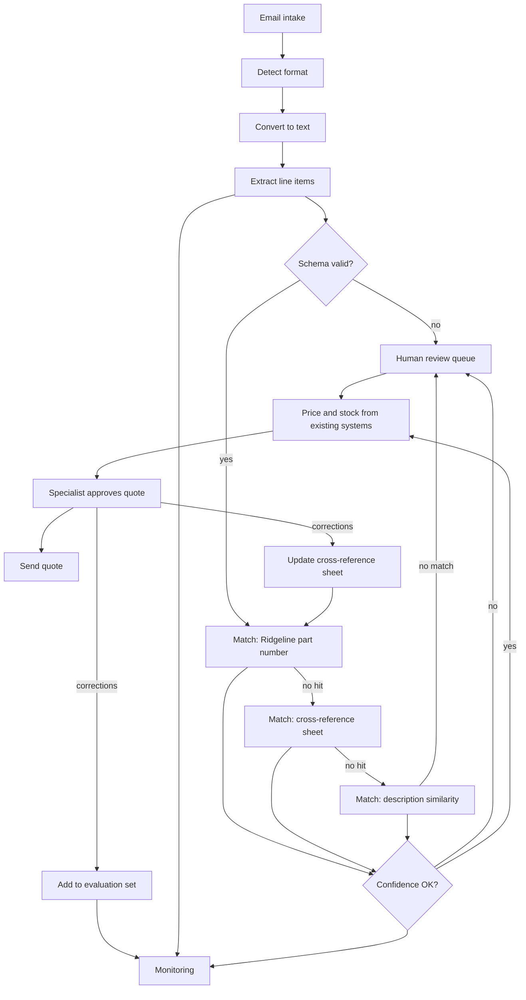

# Ridgeline Quote Desk

Turns incoming RFQs (emails, PDFs, spreadsheets, photos) into draft quotes that a person checks before anything is sent.

## Repository

https://github.com/MoizJatala/ridgeline-quote-desk

## How to Run

```bash
python -m venv .venv
source .venv/bin/activate          # Windows: .venv\Scripts\activate
pip install -r requirements.txt
cp .env.example .env               # then fill in the values
python run_pipeline.py             # writes outputs/<rfq name>.json
python evaluate.py                 # scores outputs against the answer key
python check_submission.py         # checks the submission layout
```

## Approach

### Pipeline

1. **Load.** Each RFQ file is converted to text: plain text as is, PDF text via pdfplumber, Excel rows via openpyxl. The handwritten photo RFQ is stubbed for now and goes straight to human review.
2. **Extract.** Claude Sonnet reads the text and returns line items (what the customer wrote, quantity, unit, notes) through a tool call. The result is validated against a pydantic schema; on failure it retries once, then flags the RFQ for review.
3. **Match.** Deterministic code matches each line, stopping at the first hit:
   1. Ridgeline part number written in the RFQ
   2. Competitor part number in the cross-reference sheet
   3. Description similarity against the catalog, with key specs (size, thread, pressure) required to agree
4. **Fix up.** Discontinued parts are swapped for their listed replacement, and the swap is flagged.
5. **Score.** Every line gets a confidence score. Anything below the threshold (0.8), flagged, or unmatched goes to human review.

### The decision that matters most

**The model reads documents; code picks part numbers.** The model never chooses a part number or a price. It only turns messy text into structured fields. Matching is plain code against Ridgeline's own catalog and cross-reference sheet, so every part number can be traced to a rule and a source row, and a person approves every quote.

### Model provider and region

This demo calls Claude Sonnet through the Anthropic API. In production it would run through a US regional endpoint such as Amazon Bedrock, so customer data stays in the US.

## Evaluation

`python evaluate.py` compares `outputs/` with the answer key and writes `evaluation/results.json`. The answer key covers 3 of the 6 RFQs (rfq_01, rfq_02, rfq_03), 19 lines in total.

### Results

| Metric | Score | Lines |
|---|---|---|
| Extraction accuracy | 1.00 | 19 / 19 |
| Match precision (part numbers returned that are correct) | 1.00 | 17 / 17 |
| Match recall (expected part numbers found) | 1.00 | 17 / 17 |
| Correct abstention (no part number where none should be given) | 1.00 | 2 / 2 |
| Flag accuracy | 1.00 | 19 / 19 |
| Match method accuracy | 1.00 | 19 / 19 |

All three RFQs score 1.00 on every metric, and no output line is missing from or extra to the key.

### Confidence threshold

| Cutoff | Auto-accepted | Wrong auto-accepts | Sent to review |
|---|---|---|---|
| 0.50 – 0.75 | 16 | 0 | 16% |
| **0.80 (chosen)** | **15** | **0** | **21%** |
| 0.85 | 15 | 0 | 21% |
| 0.90 | 12 | 0 | 37% |
| 0.95 | 5 | 0 | 74% |

- No cutoff produced a wrong auto-accept, so the data alone would allow a cutoff as low as 0.50.
- I kept 0.80 on purpose: 19 lines is far too few to trust a lower bar, and sending one extra line to review costs much less than quoting a wrong part.
- Perfect scores on 19 lines show the pipeline handles these examples. They don't show it will handle the next hundred RFQs.

### Growing the evaluation set

- Write answer keys for the other three RFQs (rfq_04 photo, rfq_05 forwarded chain, rfq_06 vague quantities). They hold the hardest cases: handwriting, quantities changed later in the thread, and unmapped part numbers.
- Add every RFQ a specialist corrects in production, with the corrected quote as its answer, so the set fills up with real mistakes.
- Re-check the threshold once there are a few hundred lines, and run `evaluate.py` on every prompt, model, or matching change before it ships.

## Production



### Extraction failure or a new RFQ format

- If the model's output fails schema validation twice, the whole RFQ goes to the review queue with the raw text attached, never a partial guess.
- An unknown file type is routed to review untouched; a new format gets its own loader plus sample files in the evaluation set before it is automated.
- Photos and scans stay with a person until an OCR step is added and scores well on the evaluation set.

### Monitoring and alert triggers

- Track per day: share of lines sent to review, match method mix, extraction failures, latency, and token spend.
- Alert when the review rate or extraction failure rate jumps well above its weekly baseline, or when a specialist changes a part number the system marked as high confidence.
- Alert when cross-reference rows go stale or point to discontinued parts.

### Rough cost and latency per RFQ

- One model call per RFQ, about 3k tokens in total, so a few cents at most per RFQ at Sonnet pricing.
- About 8 seconds per RFQ end to end, almost all of it the model call; matching takes milliseconds.
- The specialist's review time is the real cost, which is why the goal is fewer lines needing review, not a cheaper model.

### How reviewer corrections improve the system

- A corrected competitor part number becomes a new or fixed cross-reference row, so the next RFQ matches it at step 2 instead of by description.
- Every corrected RFQ is added to the evaluation set with the specialist's answer, so later prompt or code changes are tested against real mistakes.
- Recurring correction patterns show where to adjust the confidence threshold or the description-matching rules.

### What I'd do with two more weeks

- Add OCR for photos and scans and measure it on the evaluation set.
- Build a simple review screen showing each line's source text, match method, and confidence side by side.
- Move to a US regional endpoint and connect to the real pricing, stock, and email systems.
